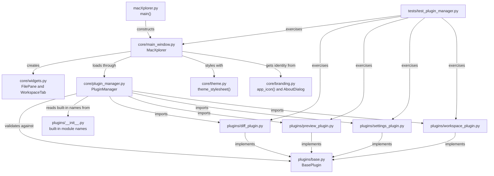
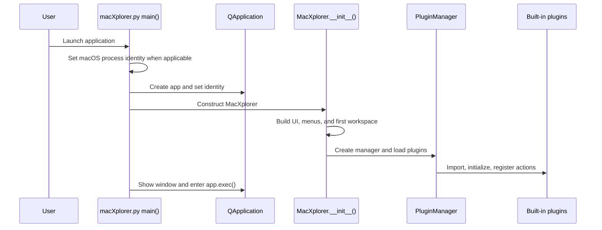

# Architecture and Technical Reference

## Repository structure

The tree below lists source, assets, tests, and documentation that define or verify application behavior. `.venv/`, `build/`, `dist/`, bytecode caches, and `.memory/` are local or generated directories ignored by `.gitignore`; they are not application source.

| Path | Responsibility |
| --- | --- |
| `macXplorer.py` | `main()`, `QApplication` creation, process identity, and event-loop entry. |
| `core/main_window.py` | `MacXplorer`, shared window state, menus, tabs, navigation, file operations, clipboard, and settings application. |
| `core/widgets.py` | `FilePane`, `WorkspaceTab`, Qt filesystem models/views, path history, selection, and focus signals. |
| `core/plugin_manager.py` | Plugin discovery, validation, initialization, and toolbar/menu registration. |
| `core/theme.py` | Preset palettes, advanced-style metadata, accessibility options, and QSS generation. |
| `core/branding.py` | Resolves runtime and packaged assets; creates the icon and About dialog. |
| `core/__init__.py` | Core package marker. |
| `plugins/base.py` | `BasePlugin` abstract contract and immutable `PluginMetadata`. |
| `plugins/__init__.py` | `BUILTIN_PLUGIN_MODULES` fallback for packaged builds. |
| `plugins/diff_plugin.py` | Folder comparison and text file diff dialogs. |
| `plugins/preview_plugin.py` | Preview plugin and text, image, and metadata preview widget. |
| `plugins/settings_plugin.py` | Settings action, General and Themes UI, validation, preview, and persistence. |
| `plugins/workspace_plugin.py` | Dual-pane toggle and navigation actions/shortcuts. |
| `tests/test_plugin_manager.py` | Qt integration and behavior tests across core and plugins. |
| `tests/__init__.py` | Test package marker. |
| `assets/macXplorer.svg` | Editable icon source. |
| `assets/macXplorer.png` | Runtime icon image packaged as application data. |
| `assets/macXplorer.icns` | macOS application bundle icon. |
| `macXplorer.spec` | PyInstaller analysis, dynamic-plugin hidden imports, resources, and bundle settings. |
| `README.md` | Project summary, installation, run/build/test commands, and documentation index. |
| `LICENSE` | MIT license text. |
| `.gitignore` | Excludes Python caches, environments, local state, macOS metadata, and build outputs. |
| `docs/user-guide.md` | User workflows and supported feature boundaries. |
| `docs/development.md` | Developer setup, plugin development, test, and build instructions. |
| `docs/references.md` | Primary framework and platform references. |
| `docs/about-nanovionlabs.md` | Verified attribution and limits on company claims. |
| `docs/license-policy.md` | Plain-language license summary. |
| `.agents/skills/` | Project-scoped repository-guide and approval-first implementation skills. |

The repository has no `requirements.txt`, `pyproject.toml`, or dependency lock file. PyQt6 is the runtime framework imported by the application. PyInstaller is a separate packaging tool invoked for bundle builds. The exact installed versions are environment-dependent and are not pinned by this repository.

## Dependency map

Arrows mean “depends on or calls into”; they do not represent user data flow.



## Startup flow

`main()` in `macXplorer.py` sets a native process name on macOS, prepares the Qt argument list, creates `QApplication`, sets application and organization names, and assigns the app icon. It constructs `MacXplorer`, shows the window, then starts `app.exec()`.

`MacXplorer.__init__()` configures app identity and preferences, applies the initial theme, and connects the system color-scheme notification when available. It calls `_build_ui()` to create the central splitter, tab widget, search field, toolbar, and first workspace. It then calls `_create_menus()`, constructs `PluginManager`, and calls `_load_plugins()`.

`PluginManager.load_plugins()` obtains module names from `pkgutil.iter_modules()` and `BUILTIN_PLUGIN_MODULES`, imports each module, identifies concrete `BasePlugin` subclasses defined by that module, validates metadata and unique IDs, invokes `initialize(core_app)`, and registers returned actions. Failures are logged and collected; `_load_plugins()` displays a warning if any occurred. Dynamic plugin imports execute Python module code in the application's process; the plugin manager does not sandbox plugins.



## Main components

| Component | Responsibility |
| --- | --- |
| `macXplorer.py` | Process identity, `QApplication` setup, and event loop. |
| `MacXplorer._build_ui()` | Central splitter, tabs, search field, toolbar, status bar, and initial workspace. |
| `MacXplorer._create_menus()` | File, Edit, View, Tools, Go, and Help menu actions and shortcuts. |
| `MacXplorer.new_tab()` | Creates a `WorkspaceTab`, connects its panes, installs context menus, and selects the left pane. |
| `MacXplorer._load_plugins()` | Invokes plugin loading and surfaces startup errors. |
| `core/widgets.py` | File-pane widgets, filesystem models, proxy filters, per-pane navigation, and workspace splitter. |
| `core/plugin_manager.py` | Runtime plugin discovery, contract checks, initialization, and action registration. |
| `core/theme.py` | Appearance options and stylesheet composition. |
| `core/branding.py` | Packaged/source asset lookup and About UI. |
| `plugins/base.py` | Plugin abstract methods and metadata type. |
| `plugins/diff_plugin.py` | Recursive folder comparison and unified text-file comparison. |
| `plugins/preview_plugin.py` | Text, image, and file metadata preview. |
| `plugins/workspace_plugin.py` | Dual-pane toggle and navigation shortcuts. |
| `plugins/settings_plugin.py` | Settings UI, validation, preview, persistence, and apply trigger. |
| `tests/test_plugin_manager.py` | Integration and behavior tests. |

## File navigation and views

Each `FilePane` has a `QFileSystemModel` configured for writable file operations, a `QSortFilterProxyModel` for filtering, and two views backed by that proxy: a `QTreeView` for details and a `QListView` for list or icon mode. The root index of each view follows the pane's current folder.

The pane maintains its own navigation history. `WorkspaceTab` owns two panes and their horizontal splitter. The main window's active pane is updated when a pane's view or path field receives focus. The `fileSelected` signal communicates active selection changes to interested plugins, including Preview.

The main search field applies a fixed string filter to each open pane's proxy model. This is a display filter, not an indexed search engine.

### Qt widgets, signals, slots, and events

`MacXplorer` subclasses `QMainWindow`. Its central widget has a vertical layout containing a search field and a horizontal `QSplitter`. The splitter contains the `QTabWidget`; `PreviewPlugin` adds its preview panel to that splitter. A `QToolBar`, menu bar, and `QStatusBar` are also attached to the window. Each `WorkspaceTab` owns a horizontal `QSplitter` and two `FilePane` widgets. A pane combines a `QFileSystemModel`, a `QSortFilterProxyModel`, a path-entry widget, and tree/list views. The proxy maps view indexes to filesystem model indexes for selection and navigation.

Signals are the main communication mechanism between widgets and the window:

| Signal/event | Producer | Consumer/effect |
| --- | --- | --- |
| `FilePane.currentPathChanged(str)` | `FilePane.navigate_to()` and current-index changes | Updates the active pane's status path and emits `MacXplorer.fileSelected`. |
| `FilePane.directoryChanged(str)` | `FilePane.navigate_to()` | Updates the workspace tab label when its workspace is current. |
| `FilePane.fileActivated(str)` | File view activation | Navigates into directories in `FilePane`; opens files through `QDesktopServices` in the main window. |
| `FilePane.focused()` and focus-aware child `focused()` signals | Pane path bar, tree, list, and view container | Select that pane as active via `MacXplorer._set_active_pane()`. |
| `MacXplorer.fileSelected(str)` | Current-index change in the active pane, pane focus, workspace change | Connected by `PreviewPlugin` to update the preview. |
| `QTabWidget.currentChanged` | Tab widget | Calls `_on_workspace_changed()` to restore that workspace's active pane and selection. |
| `QLineEdit.textChanged` | Main search box | Calls `on_search_changed()` to filter both panes in every open workspace. |
| `QAction.triggered` | Menu, toolbar, or shortcut action | Calls the corresponding core or plugin slot. |

The standard Qt event loop dispatches these events and signal-slot callbacks. Keyboard shortcuts are attached to `QAction` objects, not implemented as a separate application-level key-event loop. The file-pane focus signal is what switches the active pane, so commands such as copy, paste, navigation, and view-mode changes operate on the pane with focus.

### Navigation, tabs, and dual panes

`FilePane.navigate_to()` verifies that the target is a directory, resolves model/proxy indexes, updates view roots and the path bar, records history when requested, then emits path/directory signals. `go_back()`, `go_forward()`, `go_to_parent()`, and `go_to_home()` use the pane's history or current path. `filter_files()` updates the proxy model; `set_view_mode()` selects details, list, or icon presentation.

`MacXplorer.new_tab()` creates a `WorkspaceTab` with left and right panes, using startup settings or the active pane's current location as appropriate. It connects pane signals and context menus. `_on_workspace_changed()` restores the active pane for the selected workspace. `close_tab()` ensures that a last remaining workspace is replaced rather than leaving the tab widget empty. `WorkspaceTab.set_dual_pane()` toggles right-pane visibility; the Workspace plugin routes its toolbar/menu actions to the current workspace. The `Ctrl+Shift+D` View action also calls `MacXplorer.toggle_dual_pane()`, which delegates to the plugin when loaded and otherwise toggles the workspace directly.

### Clipboard, previews, and settings flow

| Feature | Flow |
| --- | --- |
| Copy/cut/paste | `copy_item()` or `cut_item()` calls `_set_clipboard()`, which stores the internal paths and operation and publishes local-file URLs through `QClipboard`/`QMimeData`. `paste_item()` reads that internal state (or local-file URLs from the system clipboard), checks the destination and overwrite choice, then uses `shutil` to copy or move. |
| Preview | `FilePane` focus/selection changes reach `MacXplorer.fileSelected`. `PreviewPlugin.initialize()` connects the signal to `update_preview()`. `view/showPreview` controls visibility through `PreviewPlugin.set_visible()`. |
| Preferences | `SettingsPlugin` opens `SettingsDialog`; `_save_and_accept()` validates paths, writes `QSettings`, calls `sync()`, and checks its status. The plugin then asks the core to apply settings. `MacXplorer.apply_settings()` updates pane options, preview visibility, and the stylesheet. |
| Appearance | `theme_stylesheet()` in `core/theme.py` combines the saved color preset, supported advanced style, text size, density, contrast, and color treatment. System mode uses Qt's reported color scheme, and a Qt color-scheme notification causes the core to refresh the stylesheet. |

### Shared state and dependencies

`MacXplorer` is the composition root and holds shared state used by core actions and plugins: settings (`QSettings`), current/active workspace and pane, the in-process clipboard path list and operation, and the `fileSelected` signal. Plugins receive the full core window in `initialize(core_app)` and currently access its properties/methods directly. This is a simple integration boundary, but it couples plugins to the main window API; preserve or test those call sites when changing core names or behavior.

The application uses Python standard-library modules for filesystem operations, archive handling, dynamic imports, subprocess calls, and resource discovery. PyQt6 provides the GUI, models, signals, clipboard, settings, and desktop URL opening. macOS integration is explicit rather than a cross-platform abstraction: process naming uses `ctypes` with Foundation/Objective-C when on Darwin; Finder Trash uses `/usr/bin/osascript`; Finder reveal uses `open -R`. The code does not elevate privileges or bypass OS privacy controls.

## Plugin contract

Plugins subclass `BasePlugin` in `plugins/base.py` and implement:

```python
def initialize(self, core_app: MacXplorer) -> None: ...
def register_toolbar_actions(self) -> Sequence[QAction]: ...
def get_metadata(self) -> PluginMetadata: ...
```

Plugins can optionally implement `register_menu_actions()` and return a mapping of menu titles to action sequences. `PluginMetadata` contains `plugin_id`, `name`, `description`, and `menu`.

The manager validates metadata and verifies registered actions are `QAction` objects. Plugin IDs must be unique. Modules are discovered from the `plugins` package; `plugins/__init__.py` also lists built-ins explicitly for frozen bundle compatibility. New built-in plugins must be added to that list and to `macXplorer.spec` hidden imports when needed by PyInstaller's analysis.

Plugins receive the core window object. They should use its public properties and signals where possible, avoid owning core lifecycle state, and release signal connections or widgets when the core closes.

## Settings and persistence

The core constructs `QSettings("MacExplorer", "MacExplorer")`. These existing identifiers are intentionally retained across the `macXplorer` display-name change so existing preferences remain available. Current keys include:

Branding is centralized in `core/branding.py`. The SVG in `assets/macXplorer.svg` is the editable icon source; the PNG is used at runtime, and the ICNS resource is embedded in the PyInstaller macOS bundle. The About action uses Qt's `AboutRole` so macOS can place it in the application menu. No approved product version, reverse-DNS bundle identifier, signing identity, or support channel is available; the current bundle therefore still uses PyInstaller's default identity/version placeholders and is not release-ready.

| Key | Meaning |
| --- | --- |
| `workspace/leftDirectory` | Left-pane startup location. |
| `workspace/rightDirectory` | Right-pane startup location. |
| `workspace/favorites` | Persisted list of favorite directory paths. |
| `workspace/dualPane` | Whether new workspaces show both panes. |
| `appearance/theme` | `system`, `light`, `dark`, `ocean`, `forest`, `graphite`, `warm_night`, or `terminal`; system follows Qt's reported OS color scheme. |
| `appearance/advancedStyle` | `standard`, `soft_ui`, `neon`, `paper_ui`, `outline`, `borderless`, or `card_based`; composes a Qt-compatible surface treatment with the selected color preset. |
| `appearance/textSize` | `standard`, `large`, or `extra_large` text. |
| `appearance/density` | `comfortable` or `compact` control spacing. |
| `appearance/contrast` | `standard` or `high` contrast. |
| `appearance/colorTreatment` | `standard`, `colorblind`, or `grayscale` palette treatment. |
| Advanced UI theme catalog | Searchable descriptions and implementation notes. Entries with a supported style ID synchronize with `appearance/advancedStyle`; unsupported concepts remain informational. |
| `files/showHidden` | Whether hidden file-system entries are displayed. |
| `files/confirmDelete` | Whether Trash operations require confirmation. |
| `view/showPreview` | Whether the preview panel is visible. |
| `history/recentFiles` | Recently opened local file paths. |

The settings dialog separates general preferences and appearance controls into General and Themes tabs. In the Themes tab, the Advanced style selector and searchable catalog stay synchronized for supported styles. Selecting a supported catalog entry updates the selector; selecting an unsupported entry leaves the active style unchanged. The selected style composes with the color preset, while accessibility choices take precedence for conflicting contrast and color treatments. The dialog validates startup directories before saving and calls `sync()` to persist changes. Its appearance sample renders the selected preset, advanced style, and accessibility options locally without changing the running app. `apply_settings()` updates existing panes, the preview panel, and the application stylesheet after settings are saved. In system mode, the core listens for Qt color-scheme change notifications and refreshes the stylesheet. Themes that require blur, motion, 3D rendering, or another desktop platform's widget system remain informational.

## Clipboard and file operations

macXplorer keeps an internal list of clipboard paths and whether the operation is copy or cut. It also publishes selected paths as local-file URLs through `QClipboard`/`QMimeData`, allowing compatible desktop applications to exchange files. If the internal list is empty, paste attempts to read local URLs from the native clipboard.

Copy uses `shutil.copy2` for files and `shutil.copytree` for directories. Cut uses `shutil.move`. Existing destinations require an explicit replace, skip, or cancel decision. Self-descendant copies are rejected. Folder creation, file creation, and rename validate that the requested name is a single path component.

Moving to Trash is implemented through Finder AppleScript using `/usr/bin/osascript`. Permanent recursive deletion is an internal helper used only to replace an existing destination during paste; it is not the user-facing delete action.

ZIP extraction validates archive member paths and stages extraction in a temporary sibling directory before renaming it into place. ZIP creation checks that the output is not a selected source and does not place the output inside a selected source directory.

## Verified risks and maintenance priorities

These are repository observations, not a claim that a vulnerability has been exploited. Items labeled **Potential** need targeted threat-model or runtime testing before being treated as confirmed defects.

| Priority | Status | Finding and evidence | Recommended next step |
| --- | --- | --- | --- |
| High | Verified | No dependency manifest or lock file is present, so a fresh environment cannot reproduce exact PyQt6/PyInstaller versions from repository metadata. | Adopt a supported dependency-management approach and record tested versions before release. |
| High | Verified boundary; risk depends on plugin source | `PluginManager` imports discovered modules and invokes plugin initialization in-process with the full `MacXplorer` instance. There is no plugin sandbox. | Treat the plugin directory as trusted executable code; define signing/allowlisting or another trust policy before accepting third-party plugins. |
| Medium | Potential resource-exhaustion concern | `_extract_zip_to()` validates member paths and stages extraction, but the implementation does not impose archive-size, expanded-size, member-count, or compression-ratio limits. | Add bounded extraction policy and tests if archives from untrusted sources are in scope. Path traversal checks alone do not limit resource consumption. |
| Medium | Verified test-scope limitation | The test suite is concentrated in `tests/test_plugin_manager.py` and runs with Qt offscreen; this does not verify native Finder dialogs, privacy prompts, code signing, or notarization. | Add focused tests where useful and maintain a manual macOS bundle/release checklist. |
| Medium | Verified coupling | Plugins are injected with the complete main-window object rather than a narrow typed service interface. | Keep plugin/core call sites covered by tests; consider a smaller interface only if the plugin surface grows. |
| Release gate | Verified packaging state | `macXplorer.spec` has no configured signing identity and the repository does not declare a support channel or tested release matrix. | Set release metadata, target OS versions, signing/notarization procedure, and support policy before publishing. |

### Error handling and security considerations

- File-system, subprocess, and archive failures are logged and shown in dialogs or status messages where the operation has a user-facing flow.
- ZIP member names are checked before extraction to prevent parent-path escapes.
- Item names are treated as paths and validated before creation or rename.
- Clipboard file URLs are restricted to local paths for file operations.
- Finder AppleScript invocation passes the script as an argument to `osascript`; paths are escaped before interpolation.
- The application operates with the current user's macOS file permissions. It does not elevate privileges or bypass macOS privacy controls.
- The project has no dedicated security policy, signed release process, or formal threat model in this repository. Review these before distributing to users.

## Testing and packaging

Tests use `unittest` and set Qt to offscreen mode for automation. The focused suite is:

```bash
QT_QPA_PLATFORM=offscreen python -m unittest discover -s tests -v
```

`macXplorer.spec` builds a windowed application bundle named `macXplorer.app`. Plugin modules that PyInstaller cannot detect through dynamic imports are listed in `hiddenimports`.

## Prioritized learning path

Follow the runtime path first, then trace the features through signals and plugin boundaries. The function names below are present in the current source; this order is for orientation, not a claim that every implementation detail is covered here.

1. **Launch:** `macXplorer.py` — `main()` and `set_macos_process_name()`.
2. **Composition root and startup:** `core/main_window.py` — `MacXplorer.__init__()`, `_build_ui()`, `_create_menus()`, `_load_plugins()`.
3. **Models and pane lifecycle:** `core/widgets.py` — `FilePane.__init__()`, `navigate_to()`, `filter_files()`, `selected_path()`, and `WorkspaceTab.set_dual_pane()`.
4. **Plugin contract and lifecycle:** `plugins/base.py` — `BasePlugin`; then `core/plugin_manager.py` — `load_plugins()` and validation/registration helpers; finally `plugins/__init__.py`.
5. **Tabs and active pane:** `core/main_window.py` — `new_tab()`, `close_tab()`, `_on_workspace_changed()`, `_set_active_pane()`.
6. **Clipboard and file operations:** `core/main_window.py` — `_set_clipboard()`, `paste_item()`, `_move_to_trash()`, `_create_zip()`, `_extract_zip_to()`.
7. **Plugin feature flows:** `plugins/preview_plugin.py` — `initialize()`, `update_preview()`, `set_visible()`; `plugins/diff_plugin.py`; `plugins/workspace_plugin.py`.
8. **Settings and appearance:** `plugins/settings_plugin.py` — `SettingsDialog._save_and_accept()`; `core/main_window.py` — `apply_settings()`; `core/theme.py` — `theme_stylesheet()`.
9. **Behavioral verification:** `tests/test_plugin_manager.py` — begin with startup/registration, workspace, clipboard/ZIP, preview/diff, and settings/theme tests.
10. **Distribution boundary:** `macXplorer.spec`, `core/branding.py`, `docs/development.md`, and `docs/license-policy.md`.
